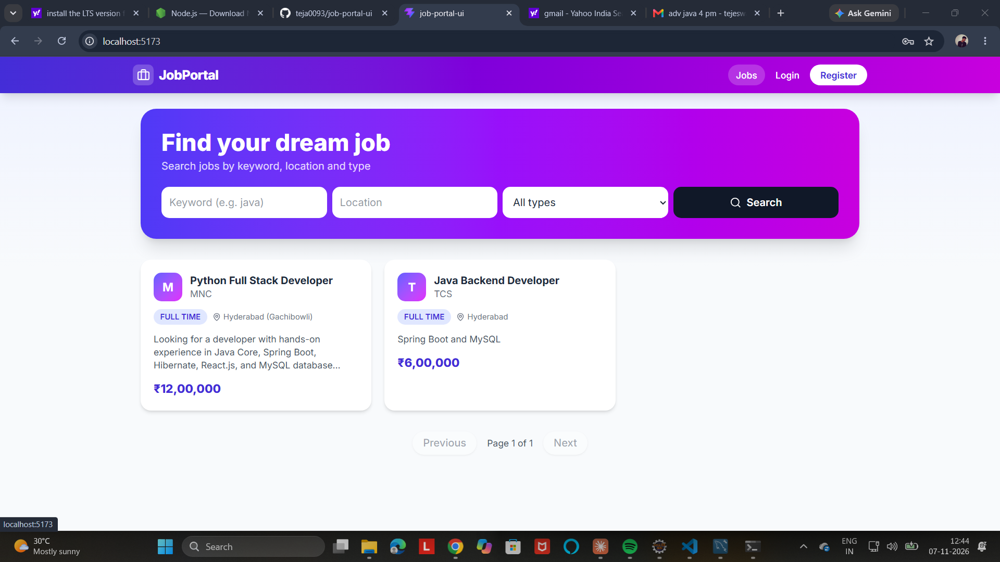
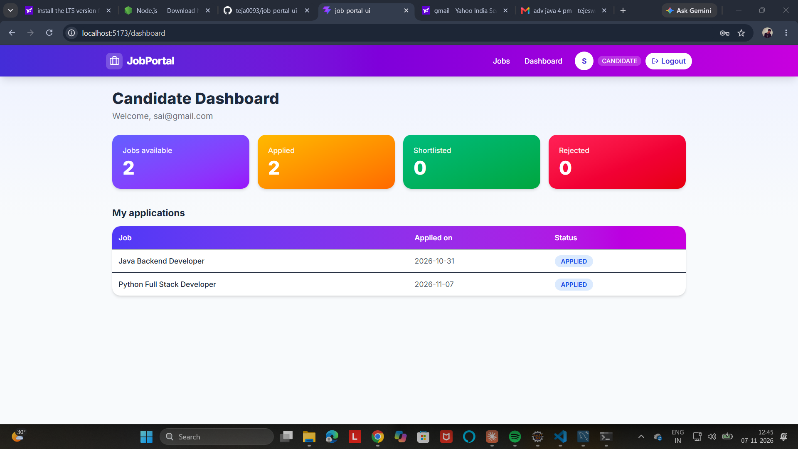

# Job Portal UI

A React frontend for the Job Portal. Candidates search and apply for jobs and track their applications. Employers post jobs, review applicants and change their status.

## Features

- Login and register with JWT authentication
- Role-based navigation and protected routes (Candidate, Employer)
- Job search by keyword, location and job type, with pagination
- Apply for jobs, with the button changing to "Applied"
- Candidate dashboard: jobs available, applied, shortlisted and rejected counts, plus an applications table
- Employer dashboard: total jobs, applicants, shortlisted and rejected counts per job
- Manage page: add companies, post jobs, view applicants and update their status

## Tech stack

React, Vite, Tailwind CSS, Axios, React Router, Lucide icons

## Screenshots






## Backend

This app needs the backend running on port 8080:
[github.com/teja0093/job-portal-api](https://github.com/teja0093/job-portal-api)

## Setup

```bash
npm install
npm run dev
```

Open http://localhost:5173

The API URL is set in `src/api.js` (`http://localhost:8080/api`).

## Author

Bonu Tejeswara Rao, [GitHub](https://github.com/teja0093)